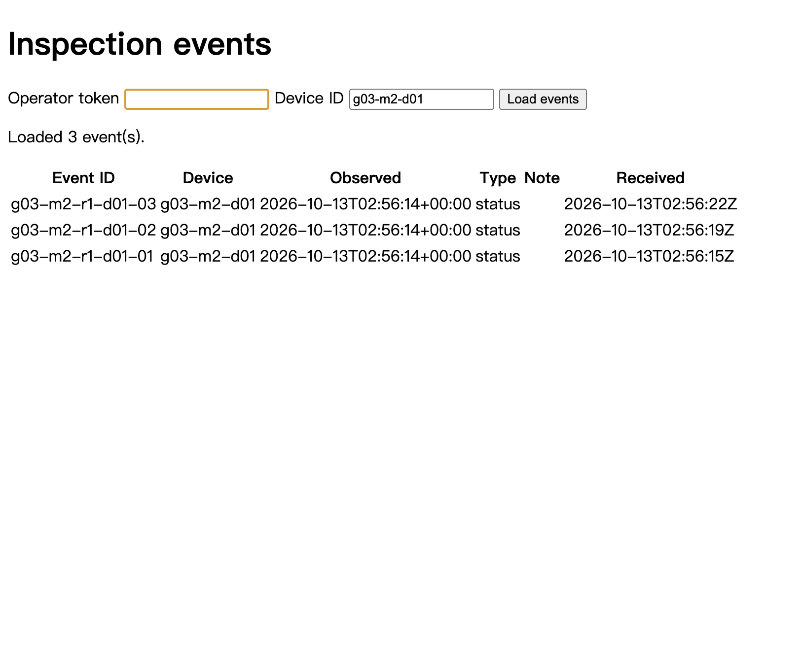

# W6 繳交：多個模擬設備回報與設備篩選

## 基本資料

- 學號：B11323211
- 姓名：傅盛祥
- 代號：g03-m2
- 個人 GitHub repo：https://github.com/spencerkuku/yuntech-cloud-student-starter
- 部署 commit：https://github.com/spencerkuku/yuntech-cloud-student-starter/commit/1437d97191615eeb4c082f572e95a25a9f39a010
- 部署後 `/health` version：`1437d97191615eeb4c082f572e95a25a9f39a010`

## 1. T1 開場

- EC2 位址：`98.93.237.64`
- 最後核對出口：`223.139.82.249/32`
- SG 只允許此 `/32` 的 TCP 22、80，沒有開放 `0.0.0.0/0`
- RDS：`available` 後完成驗收

```text
{"version":"1437d97191615eeb4c082f572e95a25a9f39a010","auth_configured":true,"db_configured":true}
```

## 2. T2 建立身分

兩份 policy 都使用精確 ARN，沒有 `*`：

```text
cxe-g03-m2-gw:
  Connect: client/gw-g03-m2
  Publish: topic/cxe/g03-m2/gw/events
cxe-g03-m2-consumer:
  Connect: client/consumer-g03-m2
  Subscribe: topicfilter/cxe/g03-m2/gw/events
  Receive: topic/cxe/g03-m2/gw/events
```

合法 MQTT：

```text
consumer: connack=0
consumer: suback=1
gateway: connack=0
gateway: puback=0
```

- [x] policy 沒有 `*`
- [x] Subscribe 使用 `topicfilter/`
- [x] 兩張憑證為 `ACTIVE`

## 3. 寫程式與審查

| 審查項目 | 確認方式 |
|---|---|
| consumer 先檢查 `device_id` | `consumer.py` 先檢查白名單，不符合即 `rejected`，不呼叫 API |
| TLS 檢查未關閉 | W6 程式沒有 `CERT_NONE` 或 `tls_insecure_set(True)` |
| policy 與憑證輸出安全 | 憑證輸出寫入檔案；policy 使用精確 ARN |

修正版 commits：

- https://github.com/spencerkuku/yuntech-cloud-student-starter/commit/506dfd89c5e5e8087095b1c894fae4fd39356eb2
- https://github.com/spencerkuku/yuntech-cloud-student-starter/commit/1437d97191615eeb4c082f572e95a25a9f39a010

本機測試：13 tests passed；Python compile 與 Shell syntax check passed。

## 4. 凍結版本並部署

```text
git rev-parse HEAD
1437d97191615eeb4c082f572e95a25a9f39a010

/health
{"version":"1437d97191615eeb4c082f572e95a25a9f39a010","auth_configured":true,"db_configured":true}

755 root /etc/inspection
600 root /etc/inspection/app.env
700 inspection /etc/inspection/iot
600 inspection /etc/inspection/iot/AmazonRootCA1.pem
600 inspection /etc/inspection/iot/consumer.cert.pem
600 inspection /etc/inspection/iot/consumer.private.key
600 inspection /etc/inspection/iot/endpoint

active
active
subscribed rc=1
```

## 5. 對帳

- 本次前綴：`g03-m2-r1`

```text
{"version": "1437d97191615eeb4c082f572e95a25a9f39a010", "db_configured": true, "prefix": "g03-m2-r1"}
puback_ok=32/32
consumer=30 result=created
      1 result=duplicate
      1 result=rejected
database=count
-------
    30
(1 row)
filtered_count=3
g03-m2-r1-d01-03
g03-m2-r1-d01-02
g03-m2-r1-d01-01
```

| 位置 | 預期 | 實際 |
|---|---:|---:|
| PUBACK | 32 | 32 |
| consumer 建立／重複／拒絕／錯誤 | 30／1／1／0 | 30／1／1／0 |
| 資料庫本次前綴 | 30 | 30 |
| d01 篩選本次前綴 | 3 | 3 |

## 6. 越權測試

```text
connack=0
puback=135
connack=0
suback=135
active
```

兩個越權操作都被 policy 拒絕，consumer 測試後已恢復 `active`。

## 7. 篩選截圖

API 實測 `device_id=g03-m2-d01` 回傳本次前綴 3 筆；已產生 `W06_篩選_B11323211.png`。

- [x] 顯示頁截圖
- [x] API 篩選結果為 3 筆

## 8. T4 保留

驗收完成後回收：

- EC2：停止
- RDS：停止
- IoT gateway certificate：`ACTIVE`
- IoT consumer certificate：`ACTIVE`
- IoT policy 保留，未建立 IAM 資源

## 9. 遇到的問題

SSH 曾因主機內部 SSH／防火牆異常而 timeout。AWS route、NACL、SG 與 EC2 status 都正常；透過暫時救援機掛載原根磁碟，修復 `sshd` 啟用狀態並停用主機防火牆，之後 SSH 恢復。W6 部署期間另修正 macOS tar extended attributes、IoT endpoint JSON 解析及 consumer endpoint 環境變數傳遞。

## 10. 用自己的話說

1. 閘道收到 32 個 PUBACK，資料庫本次前綴有 30 筆。30 筆合法事件由 consumer 建立；第一筆原樣重送成為 1 筆 duplicate；d99 在 consumer 白名單被拒絕，所以沒有送進 API。d01 篩選得到 3 筆。

2. 閘道憑證本身只證明 gateway 身分，不能證明 10 個獨立設備。拿到該憑證的人可以聲稱清單內或 d99 的 `device_id`；consumer 會放行 d01–d10，並擋下 d99。因此不能宣稱 10 個設備各有獨立憑證身分。
